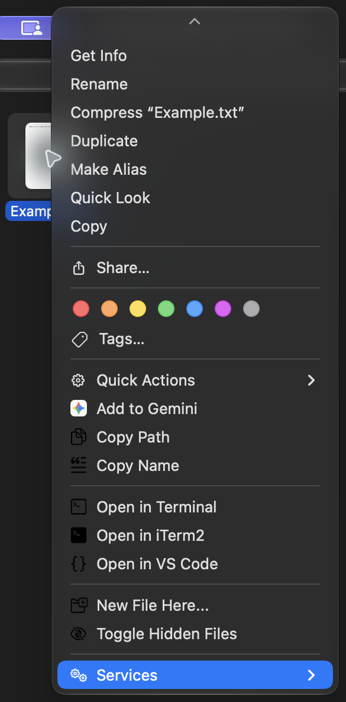

# Finder Menu Tools

<p>
  
</p>

Tiện ích Finder native giúp sao chép đường dẫn và tên, mở vị trí bằng Terminal, iTerm2 hoặc Visual Studio Code, tạo tệp rỗng và bật/tắt hiển thị tệp ẩn.

[English](README.md) · [Tiếng Việt](README.vi.md)

## Tính năng

Finder Menu Tools thêm các thao tác sau vào menu chuột phải của Finder:

- **Copy Path** — sao chép đường dẫn POSIX đầy đủ. Nhiều mục được phân cách bằng dòng mới.
- **Copy Name** — sao chép tên tệp hoặc thư mục đã chọn, gồm cả phần mở rộng của tệp. Nhiều tên được phân cách bằng dòng mới.
- **Open in Terminal** — mở thư mục được chọn; nếu chọn tệp thì mở thư mục chứa tệp đó.
- **Open in iTerm2** — chỉ hiện khi iTerm2 được cài tại `/Applications/iTerm.app`.
- **Open in VS Code** — chỉ hiện khi Visual Studio Code được cài tại `/Applications/Visual Studio Code.app`.
- **New File Here…** — tạo tệp rỗng trong thư mục hiện tại hoặc thư mục của mục được chọn đầu tiên. Không ghi đè tệp đã tồn tại.
- **Toggle Hidden Files** — bật/tắt tùy chọn hiển thị tệp ẩn của Finder và khởi động lại Finder để áp dụng.

Menu hoạt động khi chọn mục hoặc bấm chuột phải vào vùng trống trong cửa sổ Finder. Nếu chọn nhiều mục nằm ở các thư mục khác nhau, thao tác mở sẽ mở từng thư mục chứa mục đã chọn, không lặp thư mục. Tạo tệp sử dụng thư mục đầu tiên được xác định.



## Yêu cầu

- macOS 14 trở lên
- Xcode và bộ công cụ dòng lệnh để build ứng dụng macOS
- macOS có sẵn Terminal. iTerm2 và Visual Studio Code là tùy chọn; mục tương ứng chỉ hiện khi ứng dụng nằm ở đường dẫn nêu trên.

## Cài đặt

Mở Terminal và chạy:

```bash
git clone https://github.com/xuanchinh97/finder-menu-tools.git
cd finder-menu-tools
./scripts/install.sh
```

Script sẽ build bản Release, chép ứng dụng tới `/Applications/FinderMenuTools.app`, ký ứng dụng tại máy, đăng ký và bật Finder Sync extension, sau đó khởi động lại Finder. Tài khoản hiện tại cần có quyền ghi vào `/Applications`. Hãy lưu công việc đang mở trong Finder vì Finder sẽ khởi động lại.

Nếu menu chưa xuất hiện, bật **FinderMenuTools** tại **System Settings → General → Login Items & Extensions → Finder Extensions**. Tên mục có thể hơi khác tùy phiên bản macOS.

## Build bằng Xcode

Mở `FinderMenuTools.xcodeproj`, chọn scheme **FinderMenuTools**, chọn cấu hình **Release** rồi build. Để cài đặt và đăng ký extension, chạy script cài đặt ở trên.

Cũng có thể build ứng dụng host cùng extension nhúng từ Terminal:

```bash
xcodebuild \
  -project FinderMenuTools.xcodeproj \
  -target FinderMenuTools \
  -configuration Release \
  SYMROOT=build \
  CODE_SIGN_IDENTITY=- \
  CODE_SIGNING_REQUIRED=YES \
  CODE_SIGNING_ALLOWED=YES \
  clean build
```

## Khắc phục sự cố

- **Không thấy các mục trong menu:** kiểm tra FinderMenuTools đã được bật trong **System Settings → General → Login Items & Extensions → Finder Extensions**, rồi khởi động lại Finder.
- **Không thấy iTerm2 hoặc VS Code:** ứng dụng tìm các chương trình tại những đường dẫn nêu trên. Cài hoặc chuyển ứng dụng đến đúng vị trí rồi khởi động lại Finder.
- **Kiểm tra extension đã đăng ký:**

  ```bash
  pluginkit -m -v -i com.chinh.FinderMenuTools.FinderSyncExt
  ```

- **Tải lại Finder thủ công:**

  ```bash
  killall Finder
  ```

## Gỡ cài đặt

1. Tắt **FinderMenuTools** tại **System Settings → General → Login Items & Extensions → Finder Extensions**.
2. Chuyển `/Applications/FinderMenuTools.app` vào Thùng rác.

Hoặc tắt extension bằng Terminal trước khi xóa ứng dụng:

```bash
pluginkit -e ignore -i com.chinh.FinderMenuTools.FinderSyncExt
```

## Cấu trúc dự án

```text
FinderMenuTools/       Ứng dụng host xử lý thao tác menu
FinderSyncExt/         Finder Sync extension tạo menu
FinderMenuTools.xcodeproj
scripts/install.sh     Build, cài đặt, ký và bật extension
docs/                  Ghi chú kiến trúc và cài đặt
```

Tài liệu thêm: [kiến trúc](docs/architecture.md) · [hướng dẫn cài đặt](docs/usage-and-setup.md) · [nhật ký phát triển](docs/tracking-log.md)
