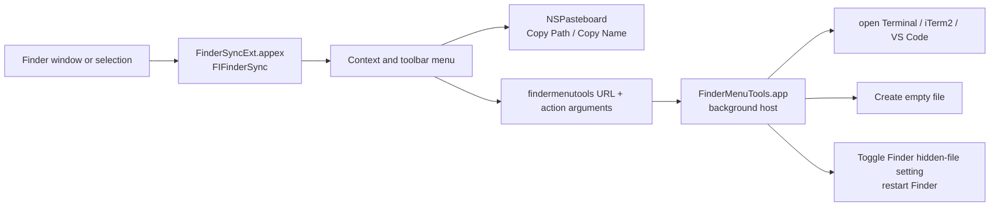

# Kiến trúc

Finder Menu Tools là ứng dụng macOS gồm một app host và một Finder Sync extension nhúng trong app. Extension tạo menu, đọc lựa chọn hoặc thư mục đích trong Finder, rồi xử lý thao tác tại chỗ hoặc chuyển hành động sang app host.

## Thành phần

### Finder Sync extension

- Source: `FinderSyncExt/FinderSync.swift`.
- Bundle identifier: `com.chinh.FinderMenuTools.FinderSyncExt`.
- Extension point: `com.apple.FinderSync`.
- Registers `/` and `/Volumes` with `FIFinderSyncController`.
- Builds menus for selected items, folder backgrounds, and the Finder toolbar. It returns no menu for the sidebar.
- Uses `selectedItemURLs()` when items are selected and falls back to `targetedURL()` for a folder background.
- Copies POSIX paths and names to the pasteboard. Open actions resolve selected files to their parent directories and deduplicate identical directories.

### Host app

- Source: `FinderMenuTools/AppDelegate.swift`.
- Bundle identifier: `com.chinh.FinderMenuTools`.
- Runs with accessory activation policy and handles requests from the extension through the `findermenutools` URL scheme and launch arguments.
- Launches Terminal, iTerm2, or VS Code with `/usr/bin/open`.
- Shows a native filename dialog for **New File Here…** and creates an empty file only when the destination does not already exist.
- Toggles `com.apple.finder`’s `AppleShowAllFiles` preference and restarts Finder.

## Extension boundary and signing

The extension is sandboxed and the host app is not. The extension handles Finder selection and menu presentation; it dispatches operations that launch applications or change Finder preferences to the host app. `scripts/install.sh` builds Release, signs the extension and host separately with local ad-hoc signing, registers the extension with `pluginkit`, enables it, and restarts Finder.

## Current scope

- iTerm2 is offered when `/Applications/iTerm.app` exists.
- VS Code is offered when `/Applications/Visual Studio Code.app` exists.
- Creating a new file with a name that already exists leaves that existing file untouched.
- When several destinations are selected for **New File Here…**, only the first resolved directory is used.
- Toggling hidden files restarts Finder to apply the changed preference.
