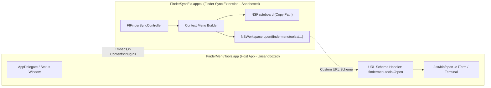

# Kiến trúc hệ thống (Architecture)

## 1. Tổng quan
`FinderMenuTools` là bộ tiện ích native hoàn chỉnh trên macOS cung cấp các tính năng tương đương và vượt trội Windows Context Menu ngay ở cấp 1 của menu chuột phải trong Finder:
1. **Copy Path**: Sao chép đường dẫn tuyệt đối (POSIX path) của Folder/File đang chọn.
2. **Copy Name**: Sao chép tên file/thư mục (kèm extension nếu có).
3. **Open in Terminal**: Mở nhanh thư mục được chọn trong Terminal mặc định của macOS.
4. **Open in iTerm2**: Tự động nhận diện và mở trong iTerm2 (chỉ hiển thị nếu máy có cài đặt iTerm2).
5. **Open in VS Code**: Tự động nhận diện và mở trong Visual Studio Code (chỉ hiển thị nếu máy có cài đặt VS Code).
6. **New File Here...**: Mở popup nhỏ cho phép nhập tên và tạo file trống (`untitled.txt`, `.md`,...) ngay tại thư mục hiện tại (tương tự `New > Text Document` trên Windows).
7. **Toggle Hidden Files**: Chuyển đổi trạng thái hiển thị file ẩn `.` trong Finder chỉ với 1 click.
8. **Settings UI**: Giao diện trực quan trong `FinderMenuTools.app` cho phép người dùng tick bật/tắt từng tính năng theo nhu cầu cá nhân.

## 2. Thành phần kiến trúc

Hệ thống bao gồm 2 target được đóng gói chung trong một ứng dụng macOS duy nhất:

### 2.1. Host App (`FinderMenuTools`)
- **Bundle Identifier**: `com.chinh.FinderMenuTools`
- **Vai trò**: macOS yêu cầu mọi App Extension (`.appex`) phải nằm trong một ứng dụng chứa (Container/Host App). Khi người dùng chạy `FinderMenuTools.app`, ứng dụng kiểm tra trạng thái kích hoạt của `FinderSyncExt` thông qua `FIFinderSyncController.isExtensionEnabled` và cung cấp nút mở nhanh phần cài đặt Extensions của hệ thống (`FIFinderSyncController.showExtensionManagementInterface()`).

### 2.2. Finder Sync Extension (`FinderSyncExt`)
- **Bundle Identifier**: `com.chinh.FinderMenuTools.FinderSyncExt`
- **Extension Point**: `com.apple.FinderSync`
- **Phạm vi giám sát**: Đăng ký `directoryURLs = [URL(fileURLWithPath: "/")]` để bắt sự kiện chuột phải trên toàn bộ ổ đĩa hệ thống cũng như các ổ đĩa gắn ngoài (`/Volumes`).
- **Xử lý đường dẫn**:
  - Ưu tiên lấy danh sách đối tượng từ `selectedItemURLs()`.
  - Fallback về `targetedURL()` nếu người dùng click chuột phải vào khoảng trống trong cửa sổ Finder.

## 3. Bảo mật, Entitlements & Code Signing
- **Yêu cầu bắt buộc của `pluginkit` (macOS App Extensions)**: Mọi Finder Sync Extension (`.appex`) bắt buộc phải có `com.apple.security.app-sandbox = true` trong entitlements, nếu không daemon `pkd` của macOS sẽ từ chối đăng ký extension.
- **Vấn đề Sandbox khi mở ứng dụng với thư mục**: Khi Extension nằm trong Sandbox gọi `NSWorkspace.shared.open([folderURL], withApplicationAt: itermURL)`, hệ thống bảo mật LaunchServices (`CoreServicesUIAgent`) sẽ chặn với lỗi `permErr: permissions error (code -54)` và hiển thị popup *"FinderMenuTools Extension does not have permission to open..."*.
- **Giải pháp Kiến trúc URL Scheme Delegation**:
  - `FinderSyncExt.appex` (sandboxed) không trực tiếp gọi mở iTerm2/Terminal bằng thư mục nữa.
  - Thay vào đó, Extension gọi mở Custom URL Scheme `findermenutools://open?app=iterm&path=...` hoặc `findermenutools://open?app=terminal&path=...`.
  - Host App `FinderMenuTools.app` (không bị Sandbox) nhận URL qua `application(_:open:)` và thực thi `/usr/bin/open -a iTerm [path]` hoặc `/usr/bin/open -a Terminal [path]` hoàn toàn tự do, không bị popup hay lỗi phân quyền chặn.
