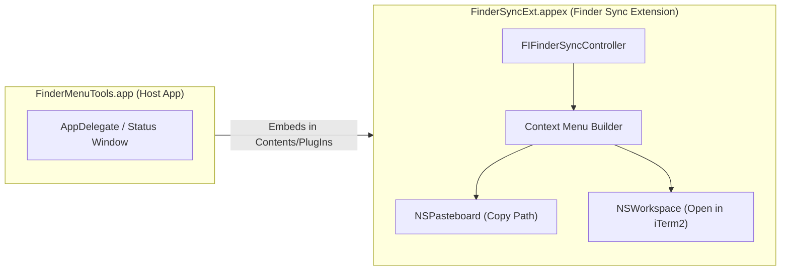

# Kiến trúc hệ thống (Architecture)

## 1. Tổng quan
`FinderMenuTools` là công cụ native trên macOS cung cấp thêm các tuỳ chọn tiện ích giống Windows ngay ở cấp 1 của menu chuột phải (Context Menu) trong Finder:
1. **Copy Path**: Sao chép đường dẫn tuyệt đối (POSIX path) của Folder/File đang chọn vào Clipboard.
2. **Open in iTerm2**: Mở nhanh cửa sổ/tab `iTerm2` tại đúng đường dẫn của Folder đang chọn (hoặc thư mục cha nếu click vào File).

## 2. Thành phần kiến trúc

Hệ thống bao gồm 2 target được đóng gói chung trong một ứng dụng macOS duy nhất:

### 2.1. Host App (`FinderMenuTools`)
- **Bundle Identifier**: `com.chinh.FinderMenuTools`
- **Vai trò**: macOS yêu cầu mọi App Extension (`.appex`) phải nằm trong một ứng dụng chứa (Container/Host App). Khi người dùng chạy `FinderMenuTools.app`, ứng dụng kiểm tra trạng thái kích hoạt của `FinderSyncExt` thông qua `FIFinderSyncController.isExtensionEnabled` và cung cấp nút mở nhanh phần cài đặt Extensions của hệ thống (`FIFinderSyncController.showExtensionManagementInterface()`).

### 2.2. Finder Sync Extension (`FinderSyncExt`)
- **Bundle Identifier**: `com.chinh.FinderMenuTools.FinderSyncExt`
- **Extension Point**: `com.apple.FinderSync`
- **Phạm vi giám sát**: Đăng ký `directoryURLs = [URL(fileURLWithPath: "/")]` để bắt sự kiện chuột phải trên toàn bộ ổ đĩa hệ thống cũng như các ổ đĩa gắn ngoài (`/Volumes`).
- **Xử lý đường dẫn**:
  - Ưu tiên lấy danh sách đối tượng từ `selectedItemURLs()`.
  - Fallback về `targetedURL()` nếu người dùng click chuột phải vào khoảng trống trong cửa sổ Finder.

## 3. Bảo mật, Entitlements & Code Signing
- **Yêu cầu bắt buộc của `pluginkit` (macOS App Extensions)**: Mọi Finder Sync Extension (`.appex`) bắt buộc phải có `com.apple.security.app-sandbox = true` trong entitlements, nếu không daemon `pkd` của macOS sẽ từ chối đăng ký extension.
- Để `FinderSyncExt` vừa thoả mãn App Sandbox của `pluginkit`, vừa có thể theo dõi toàn bộ cây thư mục gốc `/` và gọi mở ứng dụng bên ngoài (`iTerm.app`), target `FinderSyncExt` sử dụng:
  - `com.apple.security.app-sandbox = true`
  - `com.apple.security.temporary-exception.files.all.read-write = true`
- Khi ký code bằng `codesign` (Ad-hoc `-`), phải ký `FinderSyncExt.appex` trước với entitlements riêng, sau đó ký `FinderMenuTools.app` **không dùng cờ `--deep`** để tránh ghi đè entitlements của Host App lên Extension.
